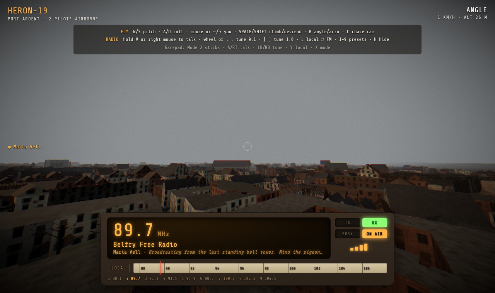
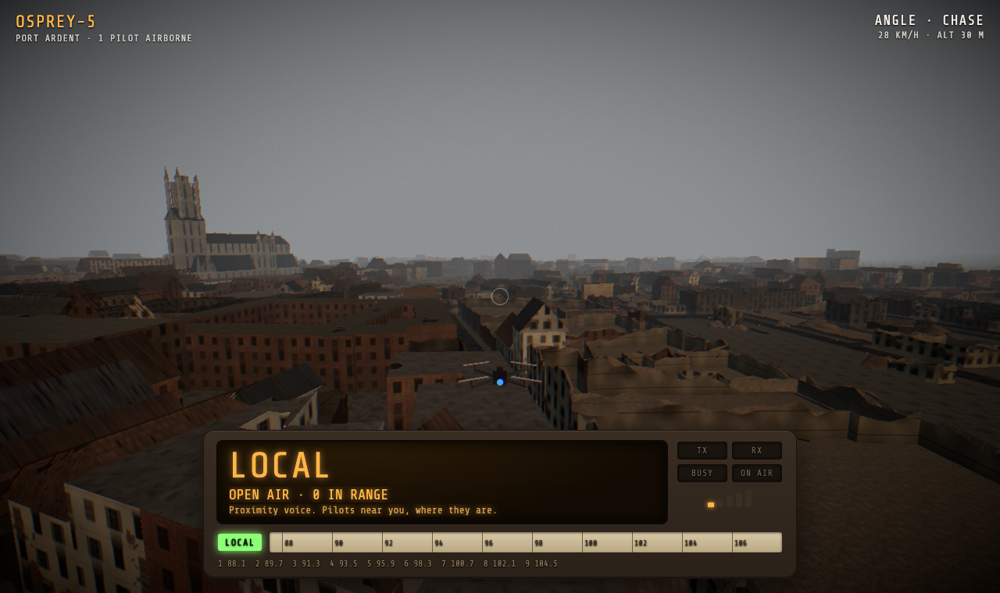

# DEAD AIR

**A walkie-talkie you fly.** You pilot an FPV drone over Port Ardent, a city two winters after the war. Your drone's radio has one dial:

- **LOCAL**: open air. You hear the pilots around you, positioned in 3D, through a handheld-radio filter. Hold the key to talk.
- **FM 87.5–108.0**: 206 frequencies, and every one of them is a station: a live AI radio show run from a basement or a bell tower. Hold the key on a station and you're a caller: *"KESTREL-7, you're on the Belfry, love."*

You can't hear both. Switching to FM gets you the whole city and makes you deaf to the drone right behind you. The dial does nothing except decide what you don't hear.





## What's built

| | |
|---|---|
| **Walkie-talkie core** | Push-to-talk, half-duplex floor control on FM (one caller at a time, BUSY lamp, refusal tone), open-air full duplex on LOCAL, 30 s transmit limit, key-up click, roger beep, squelch tail |
| **Proximity voice** | Subscribe within 120 m, drop beyond 145 m (hysteresis), HRTF panning so a voice comes from where the drone is |
| **Radio stations** | 10 hand-written stations + any other frequency invented on first tune (LLM) and stored forever. Each has a host persona, recurring bits and a voice |
| **AI call-in shows** | Host talks unprompted in segments, stops the moment a caller keys up, transcribes the caller, answers on air by callsign in about 1 s, then carries on |
| **Freeze / resume** | Show starts when the first listener tunes in, freezes when the last leaves, resumes from the exact unplayed line, with a running summary so the host remembers earlier callers |
| **World-aware shows** | Traffic, sports and dispatch hosts read live game state (pilots by landmark, recent crashes) |
| **Flight** | FPV drone with angle (self-level, altitude hold) and acro (rates) modes, Rapier collisions against the city, crash and respawn, chase cam, gamepad / FPV radio support |
| **The city** | `tools/city`: real Ghent street layout from OpenStreetMap, built headless in Blender (seeded war damage: collapsed floors, bomb holes, ~5,000 rubble piles, craters, burned cars, broken bridges), 1.2 M triangles in 17 MB, separate 145 k-triangle collision mesh. See `tools/city/README.md` |
| **Look & sound** | Post-war city (Blender, from OpenStreetMap; procedural blockout fallback), analog FPV video breakup near walls and on crash, per-band audio (warm FM host, crunchy phone-line callers, walkie-talkie LOCAL) |

## Architecture

```
                       Vercel (static)
                   ┌─────────────────────┐
  Browser ────────▶│ apps/web  Vite SPA  │  React Three Fiber · Rapier · livekit-client · Colyseus SDK
     │             └─────────────────────┘
     │ wss (Colyseus, 20 Hz)         WebRTC (LiveKit)
     ▼                                   ▼
┌──────────────────────────── one VM (docker compose) ────────────────────────────┐
│ caddy (TLS)                                                                      │
│ ├─ apps/game    Node + Colyseus 0.18                                             │
│ │    WorldRoom: poses, dial, floor control, presence        ── SQLite (WAL)      │
│ │    StationService: invent stations (Nebius Qwen), store show state/transcripts │
│ │    issues LiveKit tokens, dispatches the radio agent                           │
│ ├─ livekit-server   self-hosted SFU, rooms "local", "fm-0983", …                 │
│ └─ apps/radio   Python · LiveKit Agents worker, one host per on-air station      │
│      Claude writes the words · ElevenLabs (or Kokoro/Whisper) speaks and listens │
└──────────────────────────────────────────────────────────────────────────────────┘
```

There are three planes, kept apart on purpose:

| Plane | Carries | Tech | Rate |
|---|---|---|---|
| Control | poses, dial, PTT floor, presence | Colyseus over WebSocket | 20 Hz |
| Voice | mic audio, host audio | LiveKit SFU (WebRTC) | continuous |
| Durable | stations, show state, transcripts | SQLite, owned by the game server | a few writes/min |

The AI sits beside the voice plane, never in front of it. If the radio worker dies, you can still fly, LOCAL voice still works, and FM stations still work as walkie-talkie channels between players. Only the host goes to static.

### How a tune works

1. Turning the dial drops audio to static at once. The tune request goes out when the knob rests (350 ms debounce).
2. On an FM dial, the game server loads the station or invents it. It then makes sure a host agent is in the LiveKit room (explicit dispatch, with stale-dispatch recovery) and replies with a room token.
3. The client joins the room. Static fades to a light bed when the host's track arrives. A watchdog re-tunes if the host never shows up.
4. When the last listener leaves, the host freezes, and its state is saved after every line. After 45 s with nobody listening, the agent deletes the room. The next listener gets a fresh dispatch that resumes the show.

### Why push-to-talk makes the AI easier

Voice agents usually need voice-activity detection and turn-taking models to guess when a person has stopped talking. A walkie-talkie tells you exactly when: the caller's track **unmutes** at key-up and **mutes** at release. The agent records between those two events, transcribes once, and answers. A beep and the radio framing ("caller, you're on the air") cover the 1–2 s of latency.

## Key decisions

- **Self-hosted LiveKit + LiveKit Agents (not Pipecat).** A host's voice has to fan out to everyone tuned to 98.3, so we need an SFU either way. Pipecat's own WebRTC transport is one-to-one. LiveKit is open source, a single binary, and dispatches an agent per room.
- **Client-authoritative movement, server-validated.** FPV needs zero input lag, and drones don't collide with each other, so server authority buys nothing. The server rejects teleports and impossible speeds. Remote drones are interpolated 120 ms behind, with slerped rotation. Colyseus 0.18 has prediction and reconciliation if that changes.
- **The LLM writes words, code decides when.** The show loop, floor control, freeze/resume and the cost limits are all deterministic. Claude only writes what the host says, so a caller can't talk the host into anything that changes the game.
- **SQLite, not a "realtime DB".** 20 Hz positions live in Colyseus memory. What's durable is small and slow. One owner (the game server); the Python agent goes through internal HTTP.
- **Plain Vite SPA.** Server-side rendering does nothing for a WebGL canvas. The 3D bundle loads lazily after the start screen.

## LLMs, three ways

1. **Live hosts (Claude Haiku 5.5, low effort).** Writes 30–45 s segments and caller replies, streamed line by line, so the first line airs about 0.7 s after the model starts. Every few segments it updates a running summary, so the context stays bounded.
2. **Generated stations (Nebius `Qwen3-30B-A3B`, JSON).** Any frequency nobody has tuned to before gets a station invented on the spot: name, host persona, quirks, recurring bits, topics, banned topics, voice. The result is validated with zod, with a deterministic fallback if the LLM fails, and stored permanently.
3. **As a build tool.** The 10 curated station bibles in `stations/` were written with Claude, and the whole codebase was built with Claude Code.

## Run it locally

Prerequisites: Node 22+, pnpm, [uv](https://docs.astral.sh/uv/), `livekit-server` (`brew install livekit`), Docker (only for the local speech server), Blender 4.2+ (only to rebuild the city).

```bash
pnpm install
(cd apps/radio && uv sync)
cp .env.example .env        # set ANTHROPIC_API_KEY; NEBIUS_* and ELEVENLABS_API_KEY are optional
pnpm dev                    # speech (if no ElevenLabs key), LiveKit, game, radio worker, web
open http://localhost:5173  # two tabs = two pilots
```

**Controls.**
- Flying: W/S pitch, A/D roll, mouse or ←/→ yaw, Space/Shift climb and descend, R angle/acro, C chase cam.
- Radio: hold **V** (or right mouse) to talk, scroll wheel or `,` `.` to tune, `[` `]` to jump 1 MHz, **L** to switch between LOCAL and FM, 1–9 for presets, H for help.
- Gamepad: Mode 2.

Without an ElevenLabs key, voices come from Kokoro and transcription from faster-whisper, both in a local container (`ghcr.io/speaches-ai/speaches`). The code switches to ElevenLabs automatically when `ELEVENLABS_API_KEY` is set.

## Tests

| Command | Covers |
|---|---|
| `cd packages/shared && pnpm test` | dial math, room names, band wrap-around |
| `cd apps/web && pnpm test` | flight model (hover, pitch/roll/yaw directions, climb, acro, drag limit), snapshot interpolation |
| `cd apps/radio && uv run pytest` | host-line cleanup, prompt assembly, ElevenLabs TTS/STT adapters and voice fallback (mocked HTTP) |
| `cd apps/game && pnpm test` (stack running) | join, duplicate callsigns, tune, **half-duplex floor**, LOCAL open air, pose validation, internal auth. `TEST_GENERATION=1` also invents a station via Nebius |
| `cd apps/radio && uv run python tests/e2e_call.py 897` (stack running) | real audio: hear the host, call in with synthesized speech, host goes silent while you talk, transcript stored, host answers by callsign |
| `cd apps/web && node e2e/two-pilots.mjs` (stack + vite running) | two headless browsers with fake microphones: proximity voice, flying, tuning, host on air, trade-off (FM pilot not heard on LOCAL), BUSY + refused floor, **caller transcribed and answered**, back to LOCAL |

| `cd apps/web && node e2e/city-collide.mjs` | against the Blender city: descending stops on roofs/ground, flying into buildings crashes, respawn |
| `cd apps/web && node e2e/city-look.mjs` | loads the city, measures fps, saves FPV and chase-cam screenshots to `logs/e2e/` |

All of these pass locally as of the last run. The browser e2e passed 16/16 twice back to back, and the city loads in about 7 s at 60 fps in headless Chromium.

## Deploy

- **Web → Vercel.** Project root `apps/web`; `vercel.json` handles the pnpm workspace. Set `VITE_GAME_URL=https://game.<domain>`.
- **Everything else → one VM** (e.g. a Nebius CPU instance with a public IP). Point `game.<domain>` and `lk.<domain>` at it, fill in `.env`, then:
  `docker compose -f infra/docker-compose.yml --env-file .env up -d --build`
  Open TCP 80/443/7881 and UDP 3478 + 50000–50200. Add `--profile local-speech` to run Kokoro/Whisper on the box instead of ElevenLabs.

## Scaling (designed, not built)

| Bottleneck | First fix | Next |
|---|---|---|
| One WorldRoom holds every pose | Interest management with a spatial hash: send each client only nearby poses + per-station counts | Shard the city into cell rooms; Redis presence/driver across Colyseus processes |
| LOCAL voice is one LiveKit room | Selective subscription (built) | One LiveKit room per city cell; pilots near a border join the neighbouring cell's room |
| A hit station with 1,000 listeners | One host track forwarded by the SFU is cheap | LiveKit multi-node/cascading, or re-broadcast to HLS for passive listeners and keep WebRTC for callers |
| AI cost | Agents only run while someone listens; `MAX_ON_AIR` cap (extra stations work as plain walkie-talkie channels); Haiku at low effort; bounded context | Share pre-rendered segments across listeners of quiet stations; generate segments one ahead in batch |
| SQLite | Fine for one VM | Postgres once there is more than one game node |

## Known limitations

- The ElevenLabs path has not been run against the live API; there was no key during development. Everything was tested end to end with the local Kokoro/Whisper path, which uses the same interface.
- Movement is client-authoritative: a modified client can fly through walls. The server only bounds speed.
- Kokoro on CPU synthesizes at about 2x real time. The speaker prefetches two lines ahead, so this is fine for one VM with a handful of stations. ElevenLabs Flash is the production choice.
- New pilots spawn at the spawn point nearest someone already flying, so LOCAL always has somebody to hear in a demo.
- The radio worker measures load in shows (`MAX_SHOWS_PER_WORKER`), not host CPU. With the default CPU-based load it refused jobs whenever the machine was busy.
- The radio worker doesn't hot-reload (LiveKit Agents removed in-process reload), so restart it after editing `apps/radio`.

## Layout

```
apps/web       Vite + React Three Fiber client
apps/game      Colyseus world server, HTTP API, station service, SQLite
apps/radio     Python LiveKit Agents worker (the radio hosts)
packages/shared  protocol, dial math, station schema (zod)
stations/      curated station bibles
tools/city     OSM → Blender → glTF city pipeline
infra/         docker compose, LiveKit and Caddy config
docs/          plan, pitch, brief
```

Map data © OpenStreetMap contributors, ODbL. The city is real Ghent street data, renamed Port Ardent and damaged by script; no real city is depicted destroyed.
